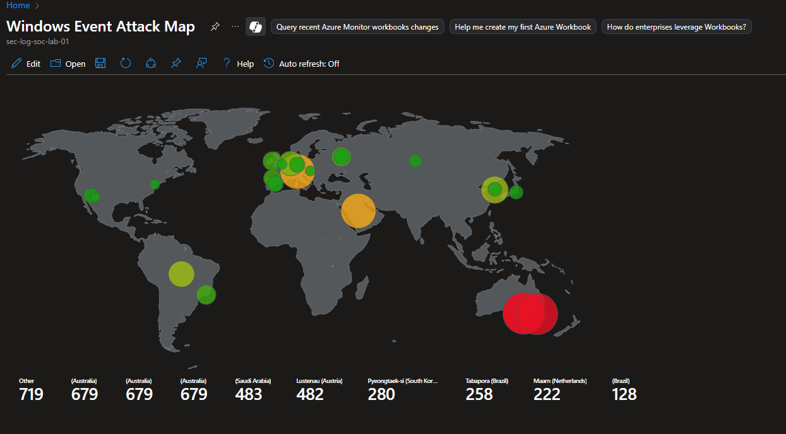
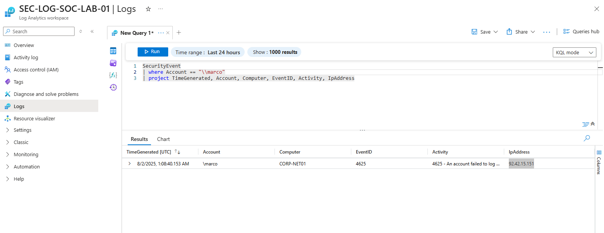
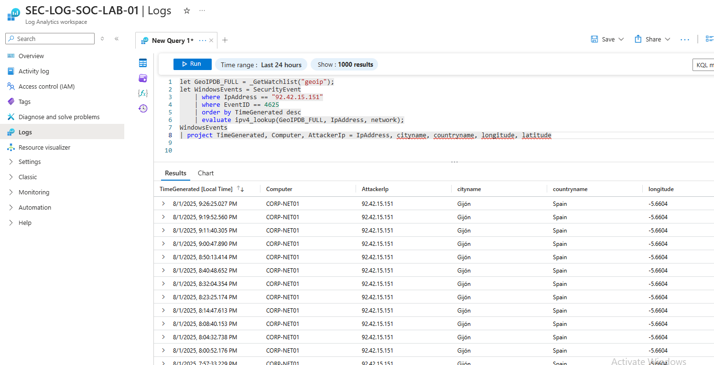
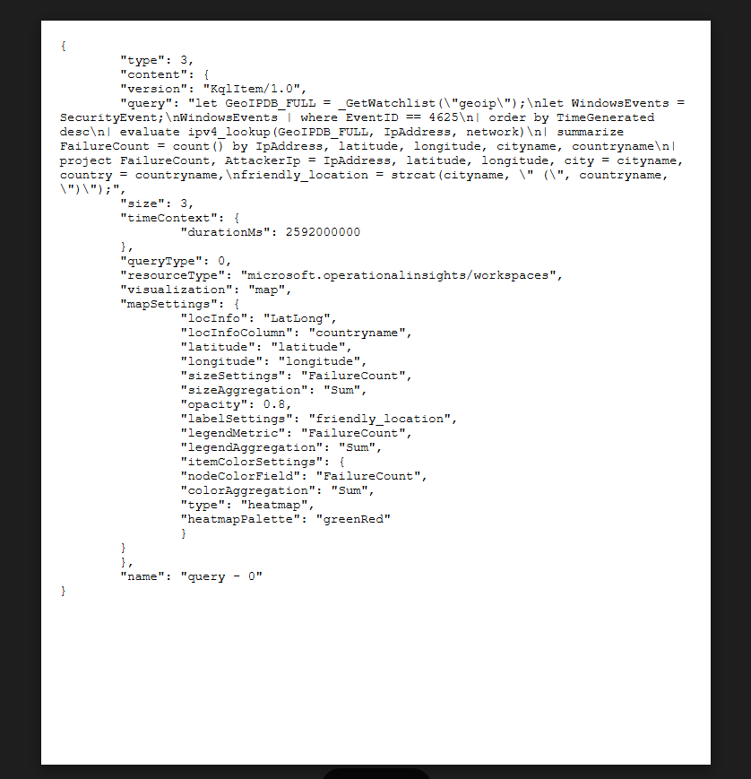

[LinkedIn: daemon-adams](https://www.linkedin.com/in/daemon-adams)

## **Azure Honeypot Detection Lab (Microsoft Sentinel)**

**Tools & Stack:**

- Azure Virtual Machine (Windows 10 Pro)
- Microsoft Sentinel (SIEM)
- Log Analytics Workspace
- Windows Event Logs (Event ID 4625)
- KQL (Kusto Query Language)
- GeoIP Enrichment + Attack Heatmap


### Professional Statement

I'm building real-world defensive security skills: cloud logging, threat detection, and incident response. This home lab showcases my ability to configure and analyze Azure environments, using Sentinel and KQL to visualize attacker data.


## Project Overview

| Phase | What I Did |
|-------|------------|
| **Deployment** | Deployed a public Windows VM honeypot, deliberately exposing it to brute-force attempts by disabling default firewall rules and inviting attacker activity |
| **Data Collection** | Captured failed login attempts (Event ID 4625) and shipped logs to Sentinel via Azure Monitor Agent |
| **Threat Correlation** | Built a GeoIP watchlist CSV and used KQL to enrich log data with attacker IP, city, country, and geo-coordinates |
| **Visualization** | Created an attack map workbook in Sentinel to display geolocated threat sources in near-real time |
| **Outcomes** | Detected unauthorized login attempts from global regions (e.g., Russia), and practiced detection engineering, SIEM configuration, and incident workflow |


## Skills & Learnings

- Azure cloud architecture and honeypot setup
- Microsoft Sentinel configuration and log forwarding
- Advanced KQL queries: conditional filters, geo enrichment, projection, summaries
- Threat detection and attribution via failed login correlation
- Mapping attacker patterns to real IP geography
- Incident reporting: identifying IOCs, providing mitigation, outlining proactive measures


## Visualization Output

Here's a sample of the attack map generated in Sentinel using enriched GeoIP telemetry:




## Real-time Visual

This is a prime example of an attacker named "marco" trying to log in to my VM. When I looked up their IP address, the location came back as *Saint Petersburg, Russia*.




## KQL Query

To view the data, go back to the Logs table in Sentinel and query for specific geo locations using the query below:

```kql
let GeoIPDB_FULL = _GetWatchlist("geoip");
let WindowsEvents = SecurityEvent
    | where IpAddress == "xx.xx.xx.xx"
    | where EventID == 4625
    | order by TimeGenerated desc
    | evaluate ipv4_lookup(GeoIPDB_FULL, IpAddress, network);
WindowsEvents
| project TimeGenerated, Computer, AttackerIp = IpAddress, cityname, countryname, longitude, latitude
```

This query extracts failed login attempts tied to a specific external IP address (the attacker who tried to log in). It correlates those events with a GeoIP watchlist and outputs useful metadata such as the host machine, timestamp, and geolocation of the attack source.



The picture below shows the KQL query I imported to resolve the country, city, state, and other location details for each corresponding IP address.


